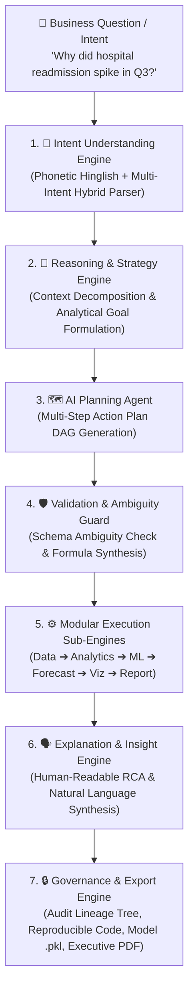
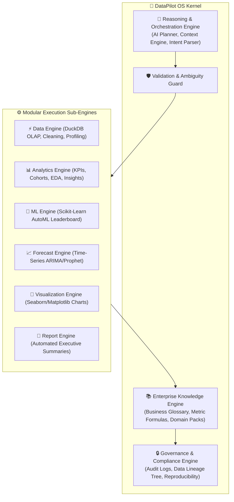

# 🚀 DataPilot OS — The AI Operating System for Data Work

```text
  ____        _        ____  _ _       _      ____  ____  
 |  _ \  __ _| |_ __ _|  _ \(_) | ___ | |_   / ___|/ ___| 
 | | | |/ _` | __/ _` | |_) | | |/ _ \| __| | |  _ \___ \ 
 | |_| | (_| | || (_| |  __/| | | (_) | |_  | |_| |___) |
 |____/ \__,_|\__\__,_|_|   |_|_|\___/ \__|  \____|____/ 
```

<p align="center">
  
  
  
  
  
</p>

---

> ### 🎯 **"From Business Questions to Trusted Decisions."**
> **An AI-Native Data Intelligence Platform that understands business intent, validates data schema, reasons through complex analytical problems, executes modular workflows, and produces explainable business decisions — 100% locally on your infrastructure.**

---

## 🌟 The Core Value Proposition

> **"Business asks questions. DataPilot produces validated decisions."**

Traditional data software forces analysts to perform tedious manual labor (clean nulls ➔ select column ➔ pick chart ➔ fit model ➔ format matrix ➔ copy into slides). 

**DataPilot OS** operates on an **Intent-Driven Orchestration Architecture**. It understands natural language business questions (in English or Phonetic Hinglish), validates schema constraints to prevent hallucinations, plans a multi-step analytical workflow, dispatches tasks across specialized engines, and delivers executive-ready **Decision Intelligence** — all with **zero data leakage**.

---

## 💼 Enterprise Business Use Cases

Enterprise organizations don't evaluate tools by feature checkboxes; they evaluate platforms by **business outcomes**:

| Domain | Business Question / Objective | Automated Output Delivered by DataPilot OS |
| :--- | :--- | :--- |
| 🏦 **Finance & Banking** | *"Why did customer churn increase in Q3?"* | Root Cause Analysis (RCA), loss driver ranking, churn risk segments, and executive PDF report. |
| 🛍️ **Retail & E-Commerce** | *"Why did our marketing campaign underperform?"* | Cohort breakdown, conversion drop-off funnel, feature attribution, and next-quarter demand forecast. |
| 🏥 **Healthcare & Clinical** | *"Why is patient readmission spiking?"* | Readmission risk factor isolation, clinical segment profiling, and HIPAA-compliant audit lineage. |
| 📈 **SaaS & Growth** | *"What if we increase subscription prices by 12%?"* | What-If scenario simulation, price elasticity curve, revenue impact forecast, and presentation slides. |
| 🔒 **Fraud & Security** | *"Detect anomalous transaction spikes."* | Statistical anomaly isolation (IQR/z-score), transaction lineage, and automated security alert logs. |

---

## 🎯 7-Step Reliable & Reproducible Reasoning Lifecycle

DataPilot OS replaces unconstrained LLM chatbot guesswork with a **deterministic, explainable reasoning pipeline**:



---

## 🏛️ The 6 Core Specialized Engines Architecture



---

## ⚙️ Core Engine Breakdown

### 1. 🧭 Reasoning & Orchestration Engine (System Brain)
- **Natural Language Intent Hierarchy Parser**: Parses complex English and Phonetic Hinglish queries (`"Sales kyun gira"`, `"Agar price 10% badha de तो kya hoga?"`).
- **AI Planning Agent**: Decomposes abstract questions into executable directed acyclic graph (DAG) analytical steps.
- **Workspace Context Engine (Native OCR Scanner)**: Proactively monitors active desktop tools (Excel, VS Code, pgAdmin, Power BI) via native Windows OCR to offer real-time contextual suggestions.

### 2. 🛡️ Validation Engine & Ambiguity Guard (Hallucination Prevention)
- **Metric Formula Synthesis**: Detects missing metrics in user prompts and automatically derives them (e.g. if `Profit` is missing, derives `Profit = Revenue - Cost`; if `Gross Margin` is missing, derives `(Revenue - Cost) / Revenue`).
- **AST Security Guard**: Pre-execution Abstract Syntax Tree scanner that intercepts malicious python system calls before execution.

### 3. ⚡ Modular Execution Engine (Multi-Engine Dispatcher)
- **Data Sub-Engine**: Multi-source ingestion (`.csv`, `.xlsx`, `.parquet`, `.json`, PostgreSQL, MySQL, SQLite, DuckDB, SQL Server) powered by DuckDB OLAP columnar storage.
- **Analytics Sub-Engine**: Automated business metrics calculation, cohort analysis, funnel tracking, and distribution profiling.
- **ML Sub-Engine**: Automated classification & regression pipeline featuring multi-model benchmark leaderboards (RandomForest, XGBoost, LightGBM, CatBoost, Logistic Regression) with zero data leakage.
- **Forecast Sub-Engine**: Time-series trend decomposition and multi-horizon predictions.
- **Visualization Sub-Engine**: Dynamic statistical charts (Heatmaps, Distributions, Pairplots, Forecasts).
- **Report Sub-Engine**: Executive summary markdown and PDF/HTML report generation.

### 4. 🧠 Intelligence Engine (Decision Intelligence)
- **Root Cause Analysis (RCA)**: Identifies primary degradation drivers and segment error distributions.
- **What-If Scenario Simulation**: Evaluates hypothetical business adjustments (price changes, discount shifts).
- **Explainable AI (XAI)**: SHAP-style feature importances and decision justifications.

### 5. 📚 Enterprise Knowledge Engine (Business Memory & Context)
- **Enterprise Business Glossary**: Standardized company metric dictionary (`Revenue`, `Gross Margin`, `Churn Rate`, `CLV`, `Readmission Rate`).
- **Domain Knowledge Packs**: Pre-configured analytical rules for Financial, Healthcare, Retail, and SaaS metrics.
- **Learning Memory (`ds_learning_memory.json`)**: Remembers user preferences, custom metric formulas, and past analytical choices across sessions.

### 6. 🔒 Governance & Compliance Engine (Air-Gapped Security)
- **Data Lineage Tree**: Maintains complete step-by-step transformation lineage from raw file ingestion to final output.
- **Structured Audit Logging**: Chronological JSON logging of user queries, actions, timestamps, and execution statuses.
- **Automated Reproducibility Exporter**: Generates a clean, standalone Python script replicating the exact data pipeline.
- **100% Offline & Local**: Zero remote API calls, zero telemetry, GDPR, HIPAA, and PCI-DSS compliant out-of-the-box.

---

## 🧰 Technology Stack

| Layer | Technology |
| :--- | :--- |
| **Frontend UI** | React 19, Vite 8, Lucide Icons, Vanilla CSS Design System |
| **Desktop Shell** | Electron 41 (ContextIsolation, Sandboxed, IPC Guard) |
| **Backend API** | Python 3.10+, FastAPI, Uvicorn, Pydantic |
| **OLAP Data Engine** | DuckDB Columnar Storage, Pandas, PyArrow, NumPy |
| **Decision Intelligence** | Scikit-Learn, Joblib, SciPy, Matplotlib, Seaborn |
| **Local LLM Engine** | Ollama (`qwen3:8b`), Local Rule-Based RAG Brain |
| **Database Support** | SQLAlchemy, PyMySQL, Psycopg2, DuckDB, SQLite3 |
| **Context OCR Scanner** | Native Windows OCR (`winocr`), Pillow, Ctypes Window Capture |

---

## 📁 Repository Directory Structure

```text
DataPilot-OS/
├── electron/
│   ├── main.cjs               # Electron main process (Security sandbox, Health polling)
│   └── preload.cjs            # ContextBridge IPC APIs
├── src/
│   ├── components/
│   │   ├── AICoPilot.jsx       # Reasoning Engine Chat & Screen Context UI
│   │   ├── DBConnectionModal.jsx # Direct SQL Database Connector Modal
│   │   ├── DataPreview.jsx     # High-Performance Data Grid
│   │   ├── DataScienceStudio.jsx # AutoML & Model Benchmark Studio
│   │   ├── ObjectExplorer.jsx  # Schema, Lineage & Business Glossary Explorer
│   │   ├── OperationPanel.jsx  # Visual Data Cleaning & Transformation Panel
│   │   ├── PropertiesPanel.jsx # Column Statistics & Profiling Sidebar
│   │   ├── ReportView.jsx      # Executive Report Generator View
│   │   ├── Ribbon.jsx          # Top Navigation Bar & Action Triggers
│   │   ├── StatusBar.jsx       # System Status & Dataset Metrics Bar
│   │   ├── TerminalHUD.jsx     # Live Python Execution Terminal
│   │   └── TitleBar.jsx        # Custom Desktop Window Controls
│   ├── App.jsx                 # Core Application Layout & Router
│   ├── main.jsx                # React Entry Point
│   └── index.css               # Design System Tokens & Styling
├── modules/
│   ├── validation_engine.py    # Schema Ambiguity Resolution & AST Guard
│   ├── execution_engine.py     # Modular Execution Sub-Engine Dispatcher
│   ├── governance.py           # Audit Logs, Lineage Tracking & Reproducibility Export
│   ├── auto_eda.py             # Automatic Exploratory Data Analysis
│   ├── auto_insights.py        # Automated Business Insights & RCA
│   ├── data_engineering.py     # Data Cleaning & DuckDB Operations
│   ├── domain_packs.py         # Financial, Healthcare & Retail Domain Packs
│   ├── forecasting.py          # Time-Series ARIMA & Diagnostic Forecasting
│   ├── intent_layer.py         # Hybrid Hinglish/English Intent Parser
│   ├── ml_engine.py            # AutoML Multi-Model Leaderboards
│   ├── planning_agent.py       # AI Multi-Step DAG Planning Agent
│   ├── report_generator.py     # Executive Summary Report Generator
│   ├── sql_engine.py           # DuckDB SQL Query Execution
│   └── visualization.py        # Enterprise Matplotlib/Seaborn Rendering
├── ds_knowledge_engine.py      # Master Knowledge Engine & Business Glossary
├── ds_learning_memory.py       # Persistent Learning Memory Store
├── server.py                   # FastAPI REST API Backend
├── DataPilot-OS.bat            # Windows One-Click Launcher
├── DataPilot-OS.sh             # Linux/macOS Launcher
├── package.json                # Frontend & Electron Configuration
├── requirements.txt            # Python Backend Dependencies
└── README.md                   # System Documentation
```

---

## 🚀 Installation & Setup Guide

### Prerequisites
1. **Node.js**: v20.19.0 or higher
2. **Python**: v3.10 or higher
3. **Ollama (Optional for LLM features)**: [Download Ollama](https://ollama.com/) (`ollama pull qwen3:8b`)

---

### Step 1: Clone Repository
```bash
git clone https://github.com/your-username/DataPilot-OS.git
cd DataPilot-OS
```

### Step 2: Set Up Python Backend Environment
```bash
# Create virtual environment
python -m venv .venv

# Activate environment (Windows)
.venv\Scripts\activate

# Activate environment (Linux / macOS)
source .venv/bin/activate

# Install dependencies
pip install -r requirements.txt
```

### Step 3: Install Frontend Dependencies
```bash
npm install
```

### Step 4: Start Application

#### Option A: Quick Launchers (Recommended)
- **Windows**: Double-click [`DataPilot-OS.bat`](file:///c:/Users/Mr/Desktop/DataPilot%20OS/DataPilot-OS.bat)
- **Linux / macOS**: Run `./DataPilot-OS.sh`

#### Option B: Developer Mode (Manual Execution)
```bash
# Terminal 1: Backend
python server.py

# Terminal 2: Frontend & Electron Shell
npm run electron:dev
```

#### Option C: Production Executable Build (.exe)
```bash
npm run dist
```
The output desktop installer will be generated in `dist-electron/`.

---

## 🛡️ Enterprise Security & Compliance

- **Zero Cloud API Dependencies**: 100% localhost execution (`127.0.0.1`).
- **AST Security Guard**: Pre-execution code verification blocks unsafe system calls.
- **Thread Safety**: Multithreaded state management protected via `threading.RLock()`.
- **Complete Privacy Compliance**: GDPR, HIPAA, and PCI-DSS compliant out-of-the-box.

---

## 📄 License & Credits

Distributed under the **MIT License**. Built with ❤️ for Data Professionals worldwide.
