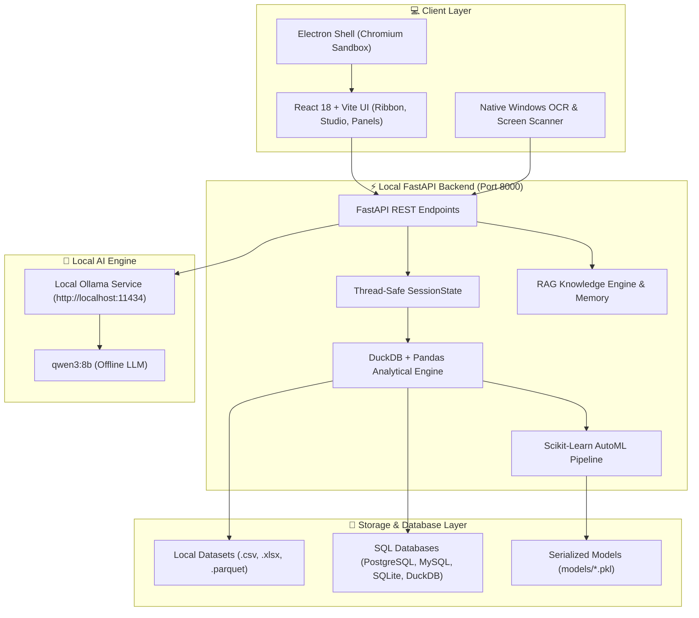

# 🚀 DataPilot OS — Air-Gapped, Privacy-First Data Science & Analytics Operating System

```text
  ____        _        ____  _ _       _      ____  ____  
 |  _ \  __ _| |_ __ _|  _ \(_) | ___ | |_   / ___|/ ___| 
 | | | |/ _` | __/ _` | |_) | | |/ _ \| __| | |  _ \___ \ 
 | |_| | (_| | || (_| |  __/| | | (_) | |_  | |_| |___) |
 |____/ \__,_|\__\__,_|_|   |_|_|\___/ \__|  \____|____/ 
```

**DataPilot OS** is a 100% offline, privacy-first Data Science Operating System designed for enterprise data scientists, financial analysts, healthcare researchers, and corporate teams. Built with a **zero-data-leakage architecture**, DataPilot OS processes datasets locally using **DuckDB**, **Pandas**, **Scikit-Learn**, and an integrated **Local Ollama LLM (`qwen3:8b`)** — ensuring sensitive corporate data never leaves your local machine or company network.

---

## 🌟 Key Highlights & Enterprise Features

- 🛡️ **100% Air-Gapped & Offline Privacy**: Zero external cloud API calls. Complete GDPR, HIPAA, and PCI-DSS compliance out of the box.
- 🗄️ **Multi-Source Data Connectors**: Connect to `.csv`, `.xlsx`, `.parquet`, `.json`, and live **PostgreSQL**, **MySQL**, **SQLite**, **DuckDB**, and **Custom SQL Server** databases in one click.
- ⚡ **High-Performance DuckDB Engine**: Query millions of rows in milliseconds using columnar OLAP storage and DuckDB SQL.
- 🤖 **AutoML & Model Serialization**: Visual classification & regression pipeline with zero data leakage (split before scaling), metric evaluation ($R^2$, MSE, Accuracy, F1, Precision, Recall), and model persistence (`models/*.pkl`).
- 🦙 **Local AI CoPilot (`qwen3:8b`)**: Natural language data science assistant running locally via Ollama with 60s timeout resilience and rule-based RAG fallback.
- 📸 **Native Windows OCR Screen Context Scanner**: Captures active workspace window context (pgAdmin, DBeaver, Excel, DataPilot OS) and screen text for contextual AI assistance.
- 💻 **Cross-Platform Standalone Desktop Shell**: Packaged with Electron 30, Chromium security sandboxing (`webSecurity: true`, `sandbox: true`), and automated backend health polling.

---

## 📐 System Architecture & Flowchart



---

## 🔄 Data Processing & AutoML Workflow Flowchart

```mermaid
flowchart LR
    A["📥 Ingest Data (Files / SQL DB)"] --> B["🧹 Visual Data Cleaning"]
    B --> C["⚙️ Feature Transformation & Encoding"]
    C --> D["📊 Exploratory Data Analysis (EDA)"]
    D --> E["🤖 AutoML Training Pipeline"]
    E --> F["🔒 Leakage-Free Train/Test Split"]
    F --> G["📈 Feature Scaling & Model Fitting"]
    G --> H["💾 Serialize Model (.pkl) & Evaluate Metrics"]
```



---

## 🧰 Technology Stack

| Layer | Technology Used |
| :--- | :--- |
| **Frontend Framework** | React 18, Vite 8, Lucide Icons, Vanilla CSS Design System |
| **Desktop Shell** | Electron 30 (ContextIsolation, Sandboxed, IPC Protocol Guard) |
| **Backend Framework** | Python 3.10+, FastAPI, Uvicorn, Pydantic |
| **Data Engine** | DuckDB, Pandas, PyArrow, NumPy |
| **Machine Learning** | Scikit-Learn, Joblib, StandardScaler, RobustScaler |
| **Local AI / LLM** | Ollama (`qwen3:8b`), Local Rule-Based Knowledge Engine (RAG) |
| **Database Support** | SQLAlchemy, SQLite3, PyMySQL, Psycopg2, DuckDB |
| **Screen OCR** | Windows Native OCR (`winocr`), Pillow, Ctypes Foreground Window Capture |

---

## ⚙️ Complete Setup & Installation Guide

### Prerequisites
1. **Node.js**: v20.19.0 or higher
2. **Python**: v3.10 or higher
3. **Ollama (Optional for LLM features)**: [Download Ollama](https://ollama.com/)

---

### Step 1: Clone the Repository
```bash
git clone https://github.com/your-username/DataPilot-OS.git
cd DataPilot-OS
```

### Step 2: Set Up Python Backend Environment
```bash
# Create virtual environment
python -m venv .venv

# Activate virtual environment
# On Windows:
.venv\Scripts\activate
# On Linux / macOS:
source .venv/bin/activate

# Install dependencies
pip install -r requirements.txt
```

### Step 3: Set Up Frontend Dependencies
```bash
npm install
```

### Step 4: Set Up Local Ollama Model (`qwen3:8b`)
```bash
# Install and pull the qwen3:8b model locally
ollama pull qwen3:8b

# Ensure Ollama service is running (default port 11434)
ollama serve
```

---

## 🚀 Running DataPilot OS

### Option A: Quick Start Launchers (Recommended)
- **Windows**: Double-click [`DataPilot-OS.bat`](file:///c:/Users/Mr/Desktop/DataPilot%20OS/DataPilot-OS.bat)
- **Linux / macOS**: Run `./DataPilot-OS.sh`

### Option B: Developer Mode (Manual Execution)
1. **Start Python FastAPI Backend**:
   ```bash
   python server.py
   ```
2. **Start Vite React Dev Server**:
   ```bash
   npm run dev
   ```
3. **Start Electron App**:
   ```bash
   npm run electron:dev
   ```

### Option C: Production Desktop Executable Build (.exe / AppImage)
```bash
npm run dist
```
The output installer will be generated in the `dist-electron/` folder.

---

## 📁 Project Structure

```text
DataPilot-OS/
├── electron/
│   ├── main.cjs               # Electron main process (Security, Sandbox, Health Checks)
│   └── preload.cjs            # ContextBridge IPC APIs
├── src/
│   ├── components/
│   │   ├── AICoPilot.jsx       # Ollama LLM Chat & Screen Scanner UI
│   │   ├── DBConnectionModal.jsx # Direct SQL Database Connector Modal
│   │   ├── ObjectExplorer.jsx  # Schema & Lab Steps Explorer
│   │   ├── OperationPanel.jsx  # Visual Data Cleaning & Transformation Panels
│   │   ├── PropertiesPanel.jsx # Column Statistics & Profiling
│   │   ├── Ribbon.jsx          # Top Navigation Bar & Action Triggers
│   │   ├── StatusBar.jsx       # System Status & Dataset Metrics Bar
│   │   ├── TerminalHUD.jsx     # Live Python Execution Terminal
│   │   └── TitleBar.jsx        # Custom Desktop Title Bar
│   ├── App.jsx                 # Core Application Layout & Tab Router
│   ├── main.jsx                # React Entry Point & ErrorBoundary Wrapper
│   └── index.css               # Design System Tokens & Global Styling
├── models/                     # Serialized Trained Machine Learning Models (.pkl)
├── ds_knowledge_engine.py      # RAG Rule-Based Knowledge Engine
├── ds_learning_memory.py       # Thread-Safe Learning Memory Store
├── server.py                   # FastAPI REST API Backend
├── requirements.txt            # Python Dependencies
├── package.json                # Node.js Dependencies & Electron Builder Config
├── DataPilot-OS.bat            # Windows Launcher Script
├── DataPilot-OS.sh             # Linux/macOS Launcher Script
└── README.md                   # System Documentation
```

---

## 🛡️ Data Security & Air-Gapped Compliance

- **No Remote Telemetry**: Zero external tracking, analytics, or pingbacks.
- **Local Network Isolation**: All REST endpoints bind to local host (`127.0.0.1` / `0.0.0.0`) and Ollama connects locally over loopback (`11434`).
- **AST Code Verification**: Python terminal commands are checked before execution.
- **Thread Safety**: State operations protected by `SessionState.lock` and `threading.RLock()`.

---
